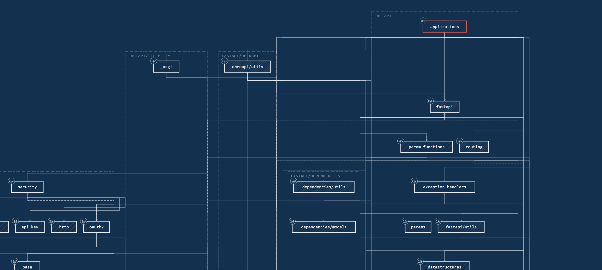
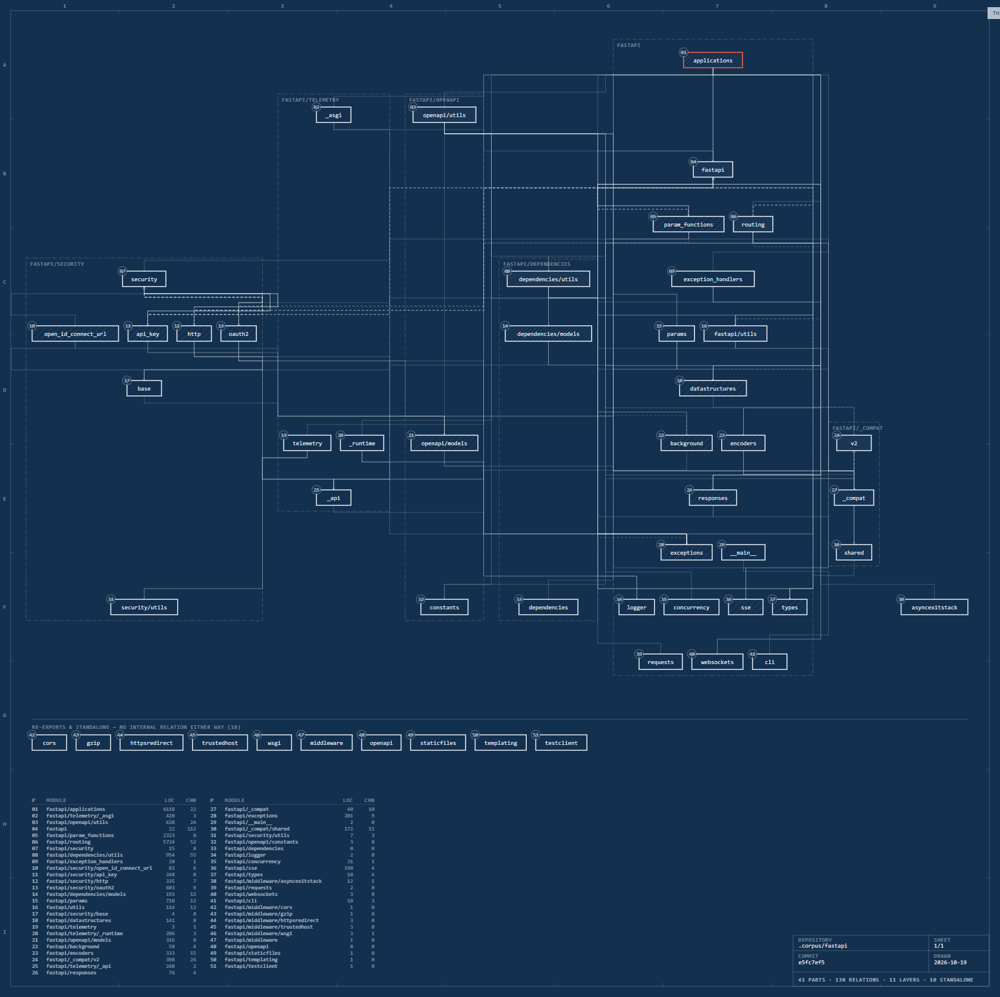
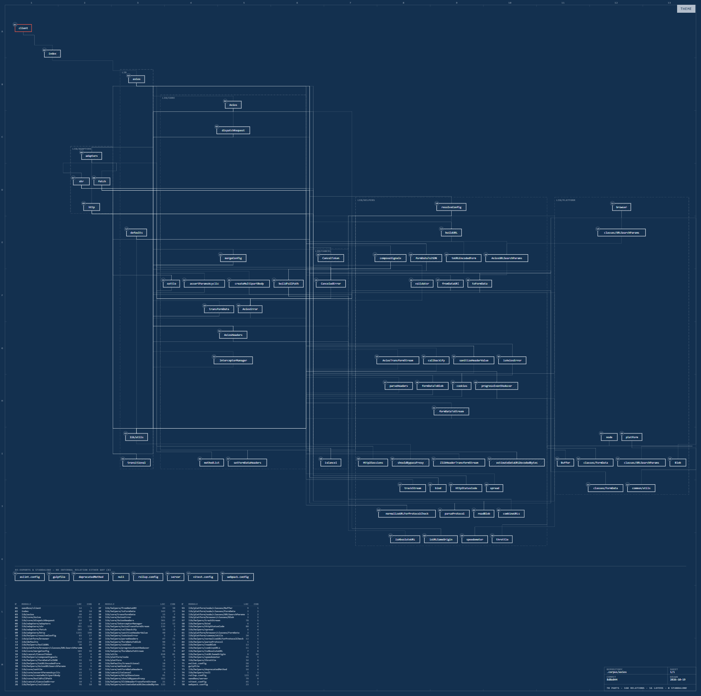
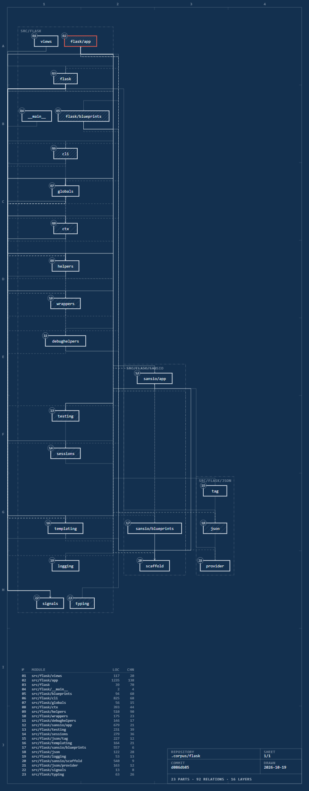
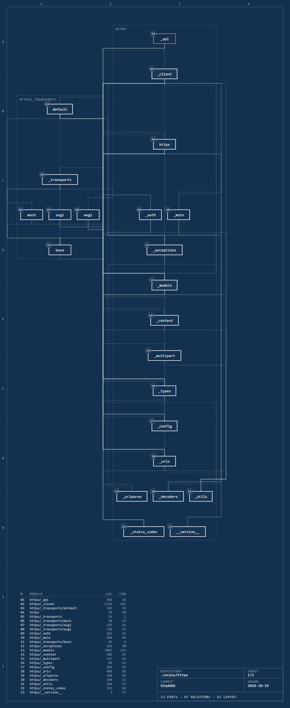
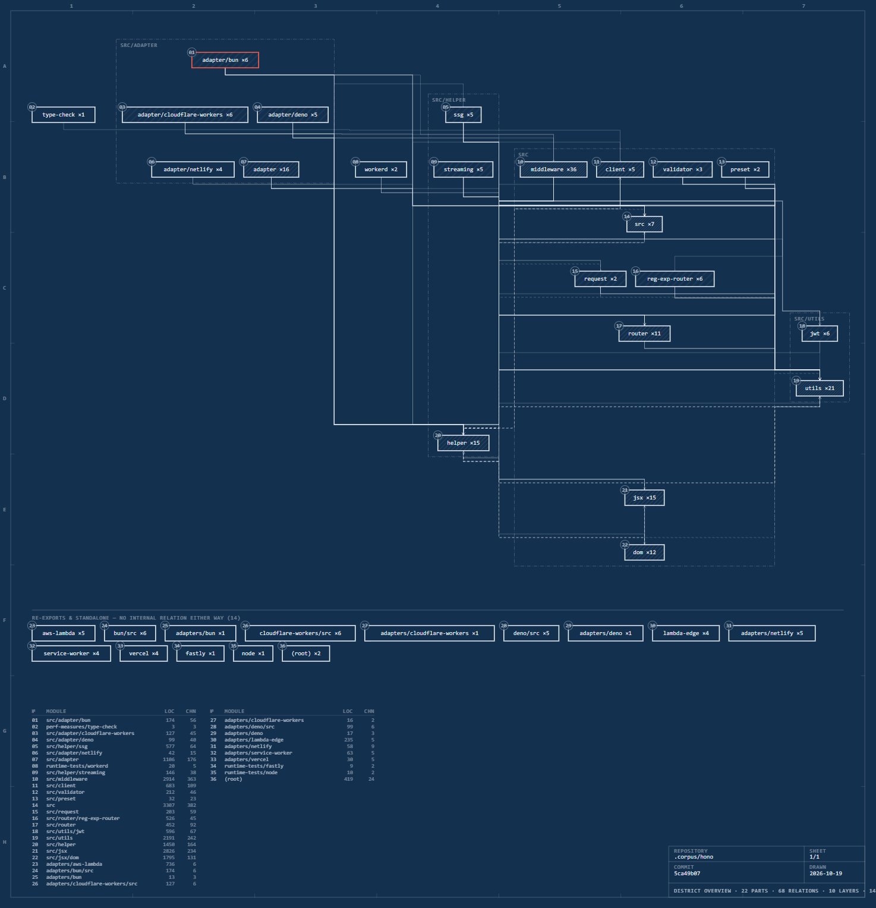
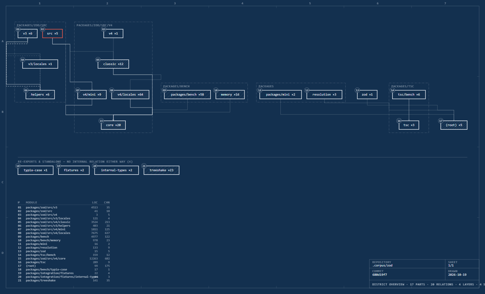
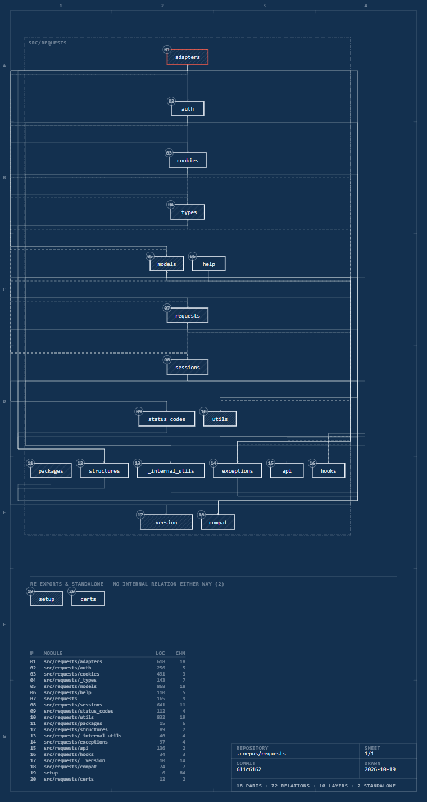
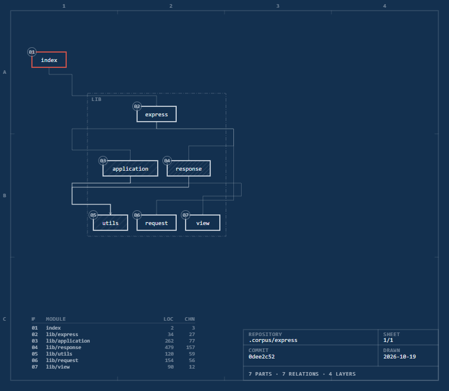

<div align="center">

# cutaway

**A cutaway drawing of your codebase.**

[](https://github.com/Arvoxis/cutaway/actions/workflows/audit.yml)
[](LICENSE)
[](https://nodejs.org)
[](package.json)

Point a coding agent at a repository and get one self-contained HTML page,
drawn like an engineering sheet. See an unfamiliar codebase's shape in ten
seconds, and find its import cycles without reading a line.



</div>

## What it is

An agent skill. Install it, then ask your agent about a codebase's
architecture and it draws one instead of guessing.

The code owns the truth and the geometry; the agent supplies the reading. The
extractor parses imports, the layout places parts by dependency depth with
directories as columns, and an **audit proves the drawing before anyone sees
it**: no part overlapping another, no relation crossing a part it does not
connect to, no label escaping its box, no balloon without a parts-list row.
Ten checks, all of which must read zero. CI runs cutaway on cutaway — if it
cannot satisfy its own spec on its own source, it has no business drawing
yours.

## Try it in thirty seconds

**The core has no dependencies.** No `npm install`, no build, no API key, and
nothing leaves your machine.

```bash
git clone https://github.com/Arvoxis/cutaway && cd cutaway
node src/extract.mjs /path/to/your/repo --out graph.json
node src/render.mjs graph.json sheet.html
```

Open `sheet.html`. Puppeteer is needed only if you want
`scripts/capture.mjs` to screenshot a sheet for you.

## Install as a skill

```bash
git clone https://github.com/Arvoxis/cutaway ~/.claude/skills/cutaway
```

Then ask: *"draw the architecture of this repo"*.

Written and tested against Claude Code. It is one `SKILL.md` plus plain Node
scripts, so it should drop into any agent that reads skills from a directory —
untested elsewhere, and reports are welcome.

## The gallery

Every sheet below is generated from the real repository by
`scripts/gallery.mjs`, not drawn by hand. Click through for the interactive
page; each ships both themes — cyanotype and vellum — with a toggle in the
corner.

<table>
<tr>
<td width="50%"><a href="examples/fastapi/sheet.html"></a><br><sub><b>fastapi</b> — 41 parts, 130 relations</sub></td>
<td width="50%"><a href="examples/axios/sheet.html"></a><br><sub><b>axios</b> — 70 parts, 160 relations</sub></td>
</tr>
<tr>
<td width="50%"><a href="examples/flask/sheet.html"></a><br><sub><b>flask</b> — 23 parts, 92 relations</sub></td>
<td width="50%"><a href="examples/httpx/sheet.html"></a><br><sub><b>httpx</b> — 23 parts, 87 relations</sub></td>
</tr>
<tr>
<td width="50%"><a href="examples/hono/sheet.html"></a><br><sub><b>hono</b> — 237 modules, drawn as 22 districts</sub></td>
<td width="50%"><a href="examples/zod/sheet.html"></a><br><sub><b>zod</b> — 246 modules, drawn as 17 districts</sub></td>
</tr>
<tr>
<td width="50%"><a href="examples/requests/sheet.html"></a><br><sub><b>requests</b> — 18 parts, 72 relations</sub></td>
<td width="50%"><a href="examples/express/sheet.html"></a><br><sub><b>express</b> — 7 parts, 7 relations</sub></td>
</tr>
</table>

## Reading the drawing

| Mark | Meaning |
|---|---|
| Box with a balloon number | A module. The number indexes the parts list |
| Row | Dependency depth — entry point on top, foundations at the bottom |
| Continuous relation | A direct import |
| Heavier relation | Three or more imports between the same pair |
| Dashed relation | An import that creates a cycle |
| Dash-dot frame | A district: one directory |
| Hatching | Churn — tighter hatch, more commits touching it |
| Red accent | The entry point |

Dashed relations are the useful ones: not every edge inside a cycle, but the
minimal set whose removal would break every cycle in the repository.

## Two zoom levels

A sheet drawn module by module stops being readable somewhere past a hundred
modules — hono's 237 would be a 4300px wall poster. So above that the drawing
zooms out on its own: one part per district, each labelled with how many
modules it stands for, relations carrying the summed import count.

```bash
node src/render.mjs graph.json sheet.html --level district   # force it
node src/render.mjs graph.json sheet.html --level module     # or override
```

## Limits

Stated plainly, because a drawing that hides what it cannot see is worse than
no drawing.

- **Python and JavaScript/TypeScript only.**
- **Imports, not calls.** Two modules that talk through a registry or
  dependency injection show no relation between them.
- **TypeScript path aliases** (`@/x`) are not resolved — a repo leaning on them
  will show fewer relations than it really has.
- **The district overview is a summary.** Above 120 modules the sheet zooms
  out, and relations inside a district stop being drawn. Pass `--level module`
  for every module, and expect a very large sheet.
- **Churn** comes from the last 2000 commits, and is zero outside a git
  repository.
- Only `source` modules are drawn. Tests, examples, scripts and vendored code
  are counted and set aside; the extractor prints the split so you can see what
  was left out.

## License

MIT.
